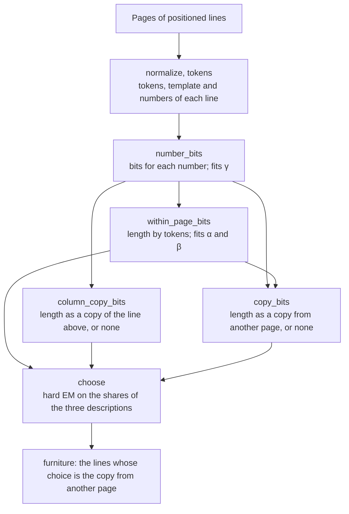

# Furniture detection

A printed page carries text that belongs to the page rather than to the book's argument: running heads, page numbers (folios), a publisher's or repository's stamp at the foot of every page. Typesetters call it furniture. Left in the text, it splits sentences that run across a page break and fills search results with book titles and page numbers.

Furniture is the part of a page that other pages already tell you. A running head on page 41 repeats the running head on page 39. The folio on page 41 is the folio on page 39 plus two. A sentence of the text, by contrast, is held by no other page, so it is predicted from the words around it on its own page.

This crate therefore finds furniture with a measure. It describes every line in three ways: by its tokens, as a copy of the line above it, and as a copy of a line on another page. A line is furniture when the copy from another page is its shortest description, measured in bits. The parameters of the descriptions are fitted to the book being read. No threshold, pattern list or trained model is involved.

The rule this measure replaced called a line furniture when it sat in the top or bottom 12% of the page and its text, with numbers masked, recurred there on at least half the pages, or when it was a bare page number there. Each of those numbers fits some layouts and fails on others: a running head that changes with every chapter recurs on far fewer than half the pages, and a repository stamp in the margin sits outside both bands. On 22 randomly drawn books that rule found 42% of what docling's layout model labels as furniture; the measure finds 97% ([evals/furniture-detection.md](../evals/furniture-detection.md)).

## Input and output

`furniture` takes a document's pages: for each page its number, and for each line its text and its box in points, with the origin at the top of the page and y growing downward. The crate does not read PDFs, so the caller builds the lines with a PDF reader. A page's number is its place in the document, not its printed folio, because a folio is expected to move on by the difference between two pages' numbers. The caller passes every page in reading order, with no lines for a page without text, so that the numbers ascend without gaps: [the search for copies](#a-copy-from-another-page-copy_bits) relies on it.

Because the measure compares pages, `furniture` reads them all at once. It returns each furniture line as a pair of its page's number and its index in that page's lines.

## Example: a running head and a folio

The crate's documentation example, at the top of `src/lib.rs`, is a book of four pages, numbered 1 to 4. Each page $n$ has the running head `On the Nature of Entropy` at the top, two lines of body text that differ from page to page, and the folio $n + 40$ at the foot. Three lines of page 2 get these lengths in bits:

| Page 2 | By its tokens | Copy of the line above | Copy from another page | Result |
|---|---|---|---|---|
| Running head | 8.60 | none | 2.00 | furniture |
| Folio `42` | 13.06 | none | 3.58 | furniture |
| First body line | 67.96 | none | none | text |

Page 1 holds the same head and its own folio at the same places, so the head and the folio are shortest as copies of them. No other page holds the body line, so it has no copy. The head has no line above it, and the lines above the folio and the body line hold other words, so none of the three is a copy of the line above.

## Background

### Probability and code length

A code writes each possible event as a string of bits. In a prefix code no codeword is the start of another, so a decoder reading bit by bit knows where each codeword ends. Four events with probabilities 1/2, 1/4, 1/8 and 1/8 get the codewords `0`, `10`, `110` and `111`, of 1, 2, 3 and 3 bits. Each length is $-\log_2 p$.

This is the rule in general: an event of probability $p$ costs $-\log_2 p$ bits, its code length. In the other direction, a prefix code with lengths $\ell_1, \ell_2, \dots$ defines probabilities $2^{-\ell_i}$ that sum to at most 1. A probability model and a code are two views of one thing, so the detector states each description as probabilities and measures it in bits.

A message of several events, each coded given the ones before it, costs the sum of their code lengths:

$$L(x_1 \dots x_n) = \sum_{i=1}^{n} -\log_2 P(x_i \mid x_1 \dots x_{i-1}) = -\log_2 P(x_1 \dots x_n).$$

`within_page_bits` codes a line this way, token by token, each token given the one before it. The detector never builds a codeword; it only adds code lengths, so a length need not be a whole number: an event of probability 0.9 costs $-\log_2 0.9 = 0.15$ bits. Such a length is still a real cost, because Shannon (1948, §9) built codes that give a message of probability $p$ between $\log_2(1/p)$ and $\log_2(1/p) + 1$ bits.

### Minimum description length

Two descriptions of the same line are two probability models of it. The shorter description comes from the model that gave the line the higher probability: $k$ bits shorter means $2^k$ times as probable. Page 2's folio in the four-page book costs 13.06 bits by its tokens and 3.58 bits as a copy of page 1's folio, so the copy makes the line $2^{9.47} \approx 710$ times as probable.

The minimum description length (MDL) principle makes this comparison the rule for choosing between explanations: prefer the one that describes the data in the fewest bits (Rissanen 1978). The comparison is fair only if each description codes the whole line and pays for every choice it makes. A copy that named its page for free could try every page and keep the best fit, so its length would no longer say how well one other page predicts the line. The copy therefore pays for its page and for each of its numbers.

Which description a line uses is a choice too. A two-part description first says which explanation it uses and then codes the data under it, so both parts count towards its length (MacKay, §28.3; Grünwald 2005, §2.4). If a share $\pi_m$ of the book's lines uses description $m$, naming it costs $-\log_2 \pi_m$ bits. A copy therefore beats the token description when $L_\text{copy} - \log_2 \pi_\text{copy} < L_\text{tokens} - \log_2 \pi_\text{tokens}$, that is, when it saves more than a threshold:

$$L_\text{tokens} - L_\text{copy} > \log_2 \frac{\pi_\text{tokens}}{\pi_\text{copy}}.$$

The threshold comes from the book's shares, not from a setting: the rarer copies are, the more a copy must save.

The detector does not charge for the weights it fits in its codes or for the shares. They are a handful of numbers for the whole book: stating them would cost the same however any one line is described, so leaving that cost out changes no decision.

### A code for whole numbers

The detector codes two kinds of whole number that have no upper limit: how many digits a number has, and how many pages lie between a line and the page it copies. A fixed-width field needs a maximum, so the detector uses the Elias gamma code (Elias 1975), which gives every positive integer a codeword and gives small integers short ones.

To code $n \ge 1$, write $n$ in binary, which takes $\lfloor \log_2 n \rfloor + 1$ digits and starts with a 1, and put $\lfloor \log_2 n \rfloor$ zeros in front. The decoder counts zeros up to the first 1 and then knows how many binary digits to read. The codeword has

$$E(n) = 2\lfloor \log_2 n \rfloor + 1$$

bits:

| $n$ | Binary | Codeword | $E(n)$ |
|---|---|---|---|
| 1 | `1` | `1` | 1 |
| 2 | `10` | `010` | 3 |
| 4 | `100` | `00100` | 5 |
| 18 | `10010` | `000010010` | 9 |

`gamma_bits` computes $E(n)$, since for a 64-bit `n >= 1`, `63 - n.leading_zeros()` is $\lfloor \log_2 n \rfloor$. The weight $\gamma$ in `number_bits` has nothing to do with the gamma code, so this document writes $E(n)$ for the code and $\gamma$ only for the weight.

The detector uses $E$ twice:

- `literal_bits(digits)`: a number written out digit by digit costs $E(\text{digits}) + \text{digits} \cdot \log_2 10$ bits, the gamma code of its length followed by $\log_2 10 = 3.32$ bits per decimal digit. One digit costs 4.32 bits and two 9.64.
- `copy_bits`: the offset from a line's page $p$ to another page $q$, by page number, costs $1 + E(|q - p|)$ bits, one bit for its sign and the gamma code of its size. The next page costs 2 bits, two pages away 4 bits, and 18 or 20 pages away 10 bits.

### Probabilities from counts

The detector estimates probabilities by counting. The obvious estimate of a token's probability is its count divided by the number of tokens counted. It fails at the first unseen token: a count of 0 gives probability 0, which costs infinitely many bits, so one new word would make a line impossible to describe.

Adding a small pseudo-count to every count removes the zeros. With $V$ possible tokens, $n$ tokens counted and $c(w)$ of them equal to $w$, the Krichevsky–Trofimov estimate adds ½ to each count:

$$P(w) = \frac{c(w) + \tfrac12}{n + \tfrac{V}{2}},$$

where the $V/2$ keeps the probabilities summing to 1. For $V = 4$ tokens counted 3, 1, 0 and 0 times:

| Count | Count / 4 | Bits | Add-½ estimate | Bits |
|---|---|---|---|---|
| 3 | 0.75 | 0.42 | 3.5 / 6 = 0.583 | 0.78 |
| 1 | 0.25 | 2 | 1.5 / 6 = 0.25 | 2 |
| 0 | 0 | infinite | 0.5 / 6 = 0.083 | 3.58 |

The frequent token pays a little more so that unseen tokens can be coded at all. The detector adds ½ twice: in the book share of a token, $P_\text{book}(w)$ in `within_page_bits`, with $V$ the book's whole vocabulary; and in the shares of the three descriptions in `choose`, $(\text{count} + \tfrac12)/(\text{lines} + \tfrac32)$.

### Mixing a specific estimate with a general one

Counts from a narrow context predict sharply but rest on few observations; counts from the whole book rest on many but ignore the context. What follows `the` is better predicted by what followed `the` elsewhere than by the book's word frequencies, unless `the` has been seen only once or twice. The detector mixes the two kinds of count with pseudo-counts. Writing $c(w)$ and $n$ for the specific counts, $G(w)$ for the general estimate and $\kappa$ for the weight that $\alpha$, $\beta$ and $\gamma$ each play in their place:

$$P(w) = \frac{c(w) + \kappa\, G(w)}{n + \kappa} = \frac{n}{n + \kappa} \cdot \frac{c(w)}{n} + \frac{\kappa}{n + \kappa} \cdot G(w).$$

The left form reads as if $\kappa$ extra observations had been made and spread over the tokens in proportion to $G$. The right form gives the specific frequency the weight $n/(n + \kappa)$ and the general estimate the rest. A context never seen ($n = 0$) falls back entirely on $G$, while a context seen many times relies mostly on its own counts. Language models call this interpolation (Jurafsky and Martin, §3.6.3).

The detector mixes at three places, each with a weight fitted to the book:

- $\beta$ mixes the counts of pairs after the previous token with a single-token estimate $P_1$ (`within_page_bits`).
- $\alpha$ mixes, inside $P_1$, the token's counts on its own page with its book share.
- $\gamma$ mixes how often a number occurs in the book with its digit-by-digit code (`number_bits`).

### Leaving the line out

Every count that codes a line comes from the rest of the book: the line's own tokens are subtracted, except those already coded earlier on the line. A decoder that knows every other line of the book, and has read this line up to the current token, can compute these counts, so the code length is the length of a code that could really be used.

Counting the line's later tokens would let the line predict itself, which favours the lines that should cost most. In the four-page book, page 2's first body line costs 67.96 bits with itself left out and would cost 20.39 bits with all its own tokens counted, while the running head would drop only from 8.60 to 7.19 bits, because other pages already predict it. Text that occurs once would look nearly as predictable as text that repeats, so the comparison with a copy would no longer ask what other text predicts.

Because every length leaves its line out, fitting $\alpha$, $\beta$ and $\gamma$ to make the book's total length shortest judges each weight by how well each line is predicted from data that excludes it, a form of cross-validation.

### Golden-section search

`minimize_log` finds the weight that makes a total code length shortest, using only the function's values. It finds the minimum of a function with one valley, one that falls to a single lowest point and rises after it; given several valleys, it settles in one of them.

It keeps an interval $[lo, hi]$ that contains the minimum and two points inside it,

$$a = hi - r\,(hi - lo), \qquad b = lo + r\,(hi - lo), \qquad r = \frac{\sqrt5 - 1}{2} \approx 0.618.$$

If $f(a) < f(b)$, a function with one valley cannot have its lowest point beyond $b$, so $hi$ moves to $b$; otherwise, a tie included, $lo$ moves to $a$. Either way the interval shrinks to $r$ of its width. Because $r^2 = 1 - r$, the inner point that survives is one of the two inner points of the new interval, so each round evaluates the function only once.

The code searches the natural logarithm of the weight, between $\ln 10^{-3}$ and $\ln 10^{7}$, because a weight can lie anywhere from a thousandth to ten million and equal steps in the logarithm treat every factor of ten alike. The search runs 48 rounds, which shrink the interval from $\ln 10^{10} = 23.03$ to $2.1 \times 10^{-9}$, and returns the exponential of the final interval's midpoint. Fitting $\beta$ in the four-page book, with $\alpha$ held at its fitted value, starts like this:

| Round | $lo$ | $a$ | $b$ | $hi$ | Total at $a$ | Total at $b$ |
|---|---|---|---|---|---|---|
| 0 | 0.001 | 6.60 | 1515 | $10^7$ | 613.62 | 699.46 |
| 1 | 0.001 | 0.229 | 6.60 | 1515 | 664.09 | 613.62 |

Round 1 reuses 6.60 and its total from round 0, so it evaluates the function only at 0.229. The search returns $\beta = 3.04$. Numerical Recipes (§10.2) explains the method step by step.

## The detector, step by step

`furniture` runs these functions in this order:

### Tokens and templates

`furniture` first normalises each line's text with `normalize` (`src/normalize.rs`): it expands the Latin ligatures U+FB00 to U+FB06 into their letters; drops soft hyphens, zero-width spaces, byte-order marks and every control character that is not whitespace; composes the text to Unicode NFC; and collapses each run of whitespace to one space. A line whose text is then empty is skipped, and so is never furniture.

`tokens` lowercases the text and splits it:

- a run of letters, in any script, is a word;
- a run of ASCII digits is a number;
- a run of letters that spells a roman numeral in its standard form, from 1 to 3999, is a number: `xiv` is 14, while `iiii`, `vx` and `ivory` are words;
- every other character except whitespace is a token of its own.

A number's token is its kind, `#` for digits and `#r` for a roman numeral, while the number itself, as written and with its value, is kept apart. The sequence of tokens is the line's template. The tokens that get coded are the template's tokens followed by an end-of-line token.

| Line | Tokens | Numbers |
|---|---|---|
| `354 \| Index` | `#` `\|` `index` | 354 |
| `Chapter XIV · 41` | `chapter` `#r` `·` `#` | `xiv` (14), `41` |
| `I mix the civil` | `#r` `#r` `the` `civil` | `i` (1), `mix` (1009) |

`354 | Index` and `352 | Index` share the template `# | index`, so a description that copies one of them states only how the number differs. The roman-numeral rule looks only at the letters, so the pronoun `I` and the word `mix`, which spell the numerals 1 and 1009, become numbers.

### Number codes: `number_bits`

`number_bits` gives each number on each line its code length, $-\log_2 P(n)$, with

$$P(n) = \frac{c(n) + \gamma\, 2^{-\ell(n)}}{N + \gamma}, \qquad \ell(n) = E(\text{digits}) + \text{digits} \cdot \log_2 10,$$

where

- $c(n)$ counts the numbers written the same way in the rest of the book, plus those earlier on the line;
- $N$ counts all numbers in the rest of the book, plus those earlier on the line;
- $\ell(n)$ is `literal_bits`, the cost of writing the number out digit by digit. A roman numeral is charged for the decimal digits of its value, so `xiv` costs what `14` costs.

$2^{-\ell(n)}$ is itself a probability over digit strings: the gamma code gives each digit count its share, and the $10^{\text{digits}}$ strings of that count split it equally. The formula is therefore the [mixing](#mixing-a-specific-estimate-with-a-general-one) of the book's counts, the specific estimate, with the digit code, the general one. A number that occurs nowhere else costs $\ell(n) + \log_2((N + \gamma)/\gamma)$ bits: its digits, plus the price of saying that it is new. `minimize_log` fits $\gamma$ to make the total over all the book's numbers shortest, so the fit follows the book:

- In the four-page book the numbers are the folios 41 to 44, each written once, so counts never help. $\gamma$ goes to the top of its range, $10^7$, so `42` costs its digits, 9.64 bits, plus $4.3 \times 10^{-7}$ bits.
- In the crate's test `a_numbered_list_down_a_column_is_not_furniture` (the list test), twelve pages each carry a list `(1)` to `(6)`, so every number recurs 12 times. $\gamma$ goes to the bottom of its range, $10^{-3}$. `1`, which occurs 11 times among the other 71 numbers, costs 2.69 bits, almost exactly $\log_2(71/11)$, instead of the 4.32 bits of its digit, while a three-digit number new to that book would cost 29.08 bits.

### The token-pair model: `within_page_bits`

`within_page_bits` describes a line by its tokens. Each token $w$ is coded given the token $v$ before it on the line, with the start of the line counting as the token before the first:

$$P(w \mid v) = \frac{c(v, w) + \beta\, P_1(w)}{c(v) + \beta}, \qquad P_1(w) = \frac{c_\text{page}(w) + \alpha\, P_\text{book}(w)}{n_\text{page} + \alpha}, \qquad P_\text{book}(w) = \frac{c_\text{book}(w) + \tfrac12}{n_\text{book} + \tfrac{V}{2}}.$$

| Symbol | Field of `TokenCounts` | What it counts |
|---|---|---|
| $c(v, w)$ | `after` | the pair $v, w$ in the rest of the book |
| $c(v)$ | `context` | pairs that start with $v$ in the rest of the book |
| $c_\text{page}(w)$ | `on_page` | $w$ on the rest of the line's page |
| $n_\text{page}$ | `page` | all tokens on the rest of the line's page |
| $c_\text{book}(w)$, $n_\text{book}$ | inside `book` | $w$, and all tokens, in the rest of the book |
| $V$ | `vocabulary` | distinct tokens in the whole book, the end-of-line token included |

The pair and book counts span the whole book, the other lines of the line's own page included. The pair part makes a common sequence cheap, such as `), pp. #–#.` at the end of a reference. The page part makes a word cheap on a page where it recurs. A line's length by its tokens is the sum of $-\log_2 P(w \mid v)$ over its tokens, the end of line included, plus the code lengths of its numbers from `number_bits`. `within_page_bits` fits $\alpha$ and $\beta$ to make the sum of the token parts over all the book's lines shortest, each in turn with the other held, starting from $\alpha = \beta = 1$: $\alpha$, then $\beta$, then both again.

In the four-page book the fit gives $\beta = 3.04$ and puts $\alpha$ at the top of its range, $10^7$, so the page counts carry almost no weight and $P_1$ is the book share: with four lines a page, the fit found no use for the page counts. In page 2's running head, the pair `the`, `nature` gets $P = (3 + 3.04 \times 0.0249)/(7 + 3.04) = 0.306$, with weight $7/10.04 = 0.70$ on the pair counts and $0.30$ on $P_1$. Every pair of the head occurs on the other three pages, so no token costs more than 2.54 bits and the head costs 8.60 bits in all. The pairs of the body line below it, `labour time measures it only where markets have`, mostly occur nowhere else. For `labour`, `time`, $c(v, w) = 0$ and $c(v) = 2$, so $P = 3.04 \times 0.00366/(2 + 3.04) = 0.0022$, 8.82 bits. Summed over its tokens, the whole line costs 67.96 bits. The folio `42` pays 2.55 bits for `#` after the start, 0.86 bits for the end after `#` and 9.64 bits for its number: 13.06 bits.

A larger book gives the weights more to work with. In the crate's test `running_heads_and_folios_are_furniture`, twelve pages each hold a running head, 30 lines of words drawn at random from a list of 24, and a folio. The fit gives $\alpha = 1865$ and $\beta = 172$. On page 5 the rest of the page holds 272 tokens, so the page counts carry weight $272/(272 + 1865) = 0.13$ in $P_1$. Because the words follow each other at random, the fit gives pair counts little weight: a pair seen 11 times carries $11/(11 + 172) = 0.06$.

### A copy of the line above: `column_copy_bits`

A list describes itself as a copy of the line above: contents-page numbers, numbered callouts down a code listing, index lines. Without this description, the second item of a list that recurs at the same place on the next page would look like furniture.

`column_copy_bits` describes a line as a copy of the line above it, its column description. The reference is the nearest line above: among the lines of the same page whose centre lies higher and whose horizontal extent overlaps the line's own, the one whose centre sits lowest on the page, the earlier line winning a tie. If no line qualifies, or the reference holds another template, the line has no column description. Otherwise the description costs, for each number, $\log_2 3 = 1.58$ bits to say which of three cases holds, plus the number's own code from `number_bits` in the third:

$$L_\text{column} = \sum_\text{numbers} \left( \log_2 3 + \begin{cases} 0 & \text{if it is the same as above, or one more} \\ -\log_2 P(n) & \text{otherwise.} \end{cases} \right)$$

In the list test, the item `(2)` on page 2 sits under `(1)` with the same template and a number one more, so it costs 1.58 bits, against 6.90 bits by its tokens and 6.28 bits as a copy from another page. `(1)` has no column description: the item ends at 64 and the body text to its right starts at x = 80, so no line above it overlaps.

### A copy from another page: `copy_bits`

`copy_bits` describes a line as a copy of the nearest line on another page. Its candidates are the pages other than the line's own that hold some line with its template, ordered by how far they sit from the line's page in `pages`, the earlier page first on a tie. On a candidate page the reference is the line nearest to this one by `distance`. If the reference holds another template, the page is skipped: holding the template somewhere on the page is not enough.

`distance` compares the two lines at three pairs of anchors: their left edges, their centres and their right edges, each anchor taken at its own line's vertical centre. It returns the smallest of the three straight-line distances, so two lines aligned on any one edge are close. Right-aligned folios `9` and `10` at the same height, both ending at x = 540, are 6 points apart at their left edges and 3 at their centres but 0 at their right edges, so their distance is 0.

The copy costs the offset to the candidate page, and for each number $\log_2 3$ bits to say whether it is the same as the reference's, moved on by the pages between them, or neither, with the number's own code in the last case. With $p$ the line's page number and $q$ the candidate's:

$$L_\text{copy} = 1 + E(|q - p|) + \sum_\text{numbers} \left( \log_2 3 + \begin{cases} 0 & \text{if it is the same, or the reference's value} + (p - q) \\ -\log_2 P(n) & \text{otherwise.} \end{cases} \right)$$

The pages are tried in candidate order and the cheapest copy is kept. Before a page is tried, the search stops if its offset plus $\log_2 3$ per number already reaches the bound: the shorter of the best copy so far and the line's length by its tokens. The result is the cheapest copy, or none when no copy is shorter than the line's length by its tokens.

On page 2 of the four-page book, the running head has no numbers, so its copy from page 1 costs the 2-bit offset alone. For the folio `42`, the candidates are pages 1, 3 and 4. Page 1 is one page back, 2 bits. Its line nearest to the folio is its own folio `41`, at distance 0 and with the same template, and 42 is 41 moved on by one page, so the number costs only $\log_2 3$. The copy costs 3.58 bits and becomes the bound. Page 3 would cost at least $2 + 1.58 = 3.58$ bits, which does not beat the bound, so the search stops.

**Why stopping early loses nothing.** Two facts make the stop exact.

- Every page still to try costs at least its offset plus $\log_2 3$ per number. Pages are tried nearest first, so offsets do not shrink: once that floor reaches the bound, no later page can come in under it.
- A copy that is not shorter than the token description saves no bits, so it clears [the threshold](#minimum-description-length) only if $\pi_\text{copy} > \pi_\text{tokens}$. While copies are no more common than token descriptions, which holds for books, the token length can serve as the bound from the start.

The first fact assumes that the page offset grows with the distance in `pages`, which holds when page numbers run without gaps. In a book numbered 96 to 100 and then 120 to 122, a stamp on page 100 with copies on pages 98 and 120 tries page 120 first, because it is next in the slice; if the stamp cost 9 bits by its tokens, the 10-bit offset would stop the search there, so the 4-bit copy from page 98 would never be tried.

### Why positions cost nothing

All three descriptions place the line in the same way, so its position would cost the same in each and drops out of the comparison; no description codes it. Position matters only by choosing the reference: the nearest line on the other page, or the line above in the column. A body line's nearest line on another page is a different sentence, so no copy exists for it.

### The decision: `choose`

Each line now has up to three lengths: by its tokens, which it always has; as a copy of the line above, or none; and as a copy from another page, or none. `choose` adds to each the cost of naming its description. The shares $\pi_m$ depend on which description each line takes, and that choice depends on the shares. Hard expectation–maximization (EM) breaks the circle by alternating:

1. Start with each share $\pi_m$ at 1/3.
2. Give each line the description with the smallest $L_m - \log_2 \pi_m$ among those it has. On a tie the token description wins, then the copy of the line above.
3. Count the shares again from those choices, adding ½: $\pi_m = (\text{lines choosing } m + \tfrac12)/(\text{lines} + \tfrac32)$.
4. Repeat until no line changes its choice, for at most `EM_ROUNDS` = 64 rounds.

The EM is hard because each line goes wholly to one description, where ordinary, or soft, EM splits it among them in proportion to $\pi_m\, 2^{-L_m}$ (Celeux and Govaert 1992). At the end every line takes its shortest description under shares counted from those same choices, and a line is furniture when that choice is the copy from another page.

[The threshold](#minimum-description-length) sets a copy against the token description. Where the line has a column description, the copy must beat that one too, by more than $\log_2(\pi_\text{column}/\pi_\text{copy})$. The three books above give these shares and thresholds:

- In the four-page book, 8 lines take their tokens, none the line above and 8 a copy. The shares are $8.5/17.5 = 0.486$, $0.5/17.5 = 0.029$ and $0.486$, so the threshold is 0 bits and each line takes its shorter description; the second round changes nothing.
- In `running_heads_and_folios_are_furniture`, 24 of the 384 lines are heads and folios. The copy share is $24.5/385.5 = 0.064$ against $0.935$ for tokens, a threshold of 3.88 bits. The running head on page 5 saves 21.79 bits by copying and the folio 14.23 bits, both more than that threshold.
- In the list test, which has no furniture, hard EM takes three rounds to settle. In the first round, with equal shares, the twelve items `(1)` take the copy from another page, which is up to 3.32 bits shorter than their tokens. The recount gives the copy a share of $12.5/433.5 = 0.029$ against $0.832$ for tokens, a threshold of 4.85 bits, so in the second round all twelve return to their tokens. The copy share falls to $0.5/433.5 = 0.0012$, the threshold rises to 9.54 bits, and the third round changes nothing.

## Two lines from real books

From Hall, *Selected Writings on Marxism*, page 365, the folio and running foot `354 | Index`:

| Description | Bits |
|---|---|
| By its tokens | 37.4 |
| As a copy from page −2 (`352 \| Index`): offset 4, number moved on by 2 pages, $\log_2 3$ | 5.6 |

In this book the token description is about 18 times as common as the copy, so its shares ask a copy to save more than 4.15 bits. This copy saves 31.8 bits, so the line is furniture.

From Weatherby, *Language Machines*, page 222, a folio `213` at the foot of the page, a place where the nearest other folio is 18 pages back:

| Description | Bits |
|---|---|
| By its tokens | 15.0 |
| As a copy from page −18: offset 10, number moved, $\log_2 3$ | 11.6 |

The copy saves 3.4 bits, below the 4.40 bits this book's shares ask for, so the folio stays in the text, which the evaluation counts as a miss.

## Limits

- The measure compares pages, so it finds furniture only where several pages share it, and none in a one-page document.
- A copy needs the same template. When the PDF reader that builds the lines extracts a letter-spaced running head with different spacing on each page (`O NTO LOG Y`, `ON TO LOG Y`), no page holds a copy, so the head stays in the text.
- Text that really does recur at the same place on nearby pages, such as code that repeats across listings, short note and citation lines with a common pattern, or a title page printed twice, is described as a copy, so it is taken for furniture.
- Furniture whose text changes on every page without a number that moves with the page, such as a source note that names a different journal at each chapter opening, has no copy, so it stays.
- A folio printed somewhere else on a few pages, such as chapter openings, can only copy from a distant page, so it may stay in the text, as the Weatherby folio above does.

## Cost

On 22 books (7,235 pages), whole PDF extraction (reading the PDF, building lines and paragraphs, and finding furniture) took 5.0 ms per page with a mean peak memory of 92 MB on an 8-core laptop CPU. The measure is one part of that work, so these figures bound its own cost from above ([evals/furniture-detection.md](../evals/furniture-detection.md)).

## References

- C. E. Shannon. A mathematical theory of communication. *Bell System Technical Journal* 27:379–423 and 623–656, 1948. Part I, §9, for codes whose lengths come within a bit of $-\log_2 p$.
- J. Rissanen. Modeling by shortest data description. *Automatica* 14(5):465–471, 1978. The paper that introduced MDL.
- D. J. C. MacKay. *Information Theory, Inference, and Learning Algorithms*. Cambridge University Press, 2003. Free to read on screen at <https://www.inference.org.uk/itila/book.html>. §28.3 for MDL as a two-part message.
- P. D. Grünwald. A tutorial introduction to the minimum description length principle. In P. D. Grünwald, I. J. Myung and M. A. Pitt (eds.), *Advances in Minimum Description Length: Theory and Applications*, MIT Press, 2005. Free as arXiv:math/0406077. Chapter 1 for the idea without mathematics; §2.4 for two-part MDL.
- P. Elias. Universal codeword sets and representations of the integers. *IEEE Transactions on Information Theory* 21(2):194–203, 1975. The origin of the gamma code.
- R. E. Krichevsky and V. K. Trofimov. The performance of universal encoding. *IEEE Transactions on Information Theory* 27(2):199–207, 1981. The origin of the add-½ estimate.
- D. Jurafsky and J. H. Martin. *Speech and Language Processing*, 3rd ed., draft of 19 August 2026. Free at <https://web.stanford.edu/~jurafsky/slp3/>. §3.6.3 for interpolation.
- W. H. Press, S. A. Teukolsky, W. T. Vetterling and B. P. Flannery. *Numerical Recipes: The Art of Scientific Computing*, 3rd ed. Cambridge University Press, 2007. Readable on screen at <https://numerical.recipes/book.html>. §10.2 for golden-section search.
- G. Celeux and G. Govaert. A classification EM algorithm for clustering and two stochastic versions. *Computational Statistics & Data Analysis* 14(3):315–332, 1992. Free as INRIA research report RR-1364 (1991) at <https://inria.hal.science/inria-00075196>. Defines classification EM, the hard EM that `choose` runs.
