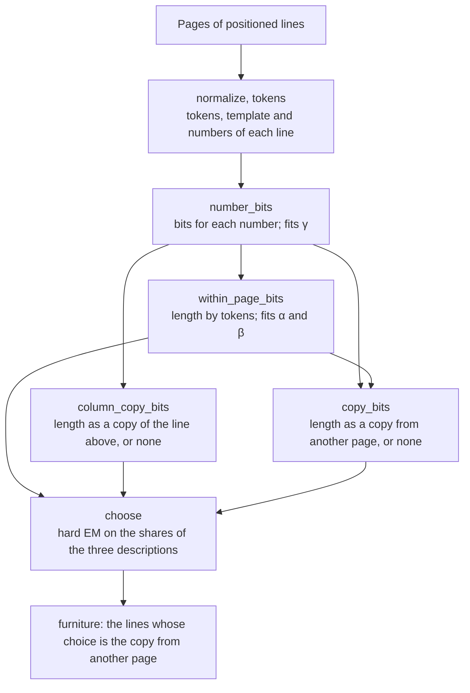
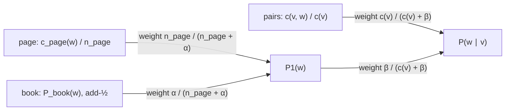

# Furniture detection

A printed page carries text that belongs to the page rather than to the book's argument: running heads, page numbers (folios), a publisher's or repository's stamp at the foot of every page. Typesetters call it furniture. Left in the text, it splits sentences that run across a page break and fills search results with book titles and page numbers.

This crate finds the furniture of a PDF with a measure instead of rules. Every line is described in three ways, each description has a length in bits, and the shortest description decides what the line is. The parameters of the descriptions are fitted to the book being read. No threshold, pattern list or trained model is involved.

The code is in `src/lib.rs`. [An overview](#overview-a-running-head-and-a-folio) follows one running head and one folio through it. [Background](#background) explains the ideas from information theory and statistics that the code relies on, for a reader who has not met them; a reader who knows code lengths, minimum description length and expectation–maximization can skip it. [The detector, step by step](#the-detector-step-by-step) then follows the code in the order it runs, with a worked example at each step.

## Input and output

`furniture` takes the positioned text lines of a document's pages: for each page its number, and for each line its text and its box in points, with the origin at the top of the page and y growing downward. The crate does not read PDFs, so the caller builds the lines with a PDF reader. The pages come in reading order with ascending page numbers. A page's number is its place in the document, not its printed folio, because a folio is expected to move on by the difference between two pages' numbers.

The measure works by comparing pages, so it reads all pages at once. It returns each furniture line as a pair of its page's number and its index in that page's lines. A line whose text is empty after normalisation is never furniture.

## The idea

Furniture is the part of a page that other pages already tell you. A running head on page 41 repeats the running head on page 39. The folio on page 41 is the folio on page 39 plus two. A sentence of the text, by contrast, is predicted by the words around it on its own page, and no other page holds it.

Video coding uses the same distinction. A frame is coded partly from its own pixels (intra prediction) and partly from the previous frame (inter prediction), and the static background ends up coded from the previous frame because that is cheaper. Here a page is a frame, and furniture is what is cheaper to code from another page.

Minimum description length makes this a decision rule: of several ways to describe the data, prefer the one that describes it in fewer bits. A description must pay for everything it uses, including which other page it copies from, so a copy wins only when the other page really predicts the line. [Background](#background) explains what a length in bits is and why comparing lengths is a fair test.

## Overview: a running head and a folio

The crate's documentation example (in the README and at the top of `src/lib.rs`) is a book of four pages, numbered 1 to 4. Each page $n$ has the running head `On the Nature of Entropy` at the top, two lines of body text that differ from page to page, and the folio $n + 40$ at the foot. On page 2, the detector treats the running head, the folio `42` and the first body line as follows.

1. **Tokens.** The head becomes the tokens `on the nature of entropy`. The folio becomes the single token `#`, with the number 42 kept apart. A line's tokens, with each number reduced to its kind, form its template, so the four folios share one template.
2. **Number codes.** No other line in the book holds 42, so the number costs what writing out its two digits costs: 9.64 bits.
3. **By its tokens.** Each token is coded from the token before it, by how often that pair occurs on the book's other lines. The other three running heads hold the same pairs, so the head costs 8.60 bits. The folio costs 3.41 bits for `#` and the end of the line, plus 9.64 bits for its number: 13.06 bits. The body line's word pairs occur nowhere else, so it costs 67.96 bits.
4. **A copy of the line above.** The head has no line above it, and above the folio is body text with another template, so none of the three lines has this description.
5. **A copy from another page.** Page 1 holds the same head at the same place, so the head can be described as "the line at this place on the previous page": 2 bits to name the page and nothing more. The folio is "the line at this place on the previous page, its number moved on by one page": 2 bits for the page and 1.58 bits to say that the number moved, 3.58 bits in all. No other page holds the body line's template, so it has no copy.
6. **The decision.** Saying which description a line uses costs bits too, more for a description that few lines use. In this small book half the lines are heads and folios, so the copy and the token description are equally common and cost the same to name. Each line therefore takes its shorter description.

| Page 2 | By its tokens | Copy of the line above | Copy from another page | Result |
|---|---|---|---|---|
| Running head | 8.60 | none | 2.00 | furniture |
| Folio `42` | 13.06 | none | 3.58 | furniture |
| First body line | 67.96 | none | none | text |

The functions run in this order:

## Background

### Probability and code length

A code writes each possible event as a string of bits. In a prefix code no codeword is the start of another, so a decoder reading bit by bit knows where each codeword ends. A fair coin needs 1 bit: heads `0`, tails `1`. Four events with probabilities 1/2, 1/4, 1/8 and 1/8 get the codewords `0`, `10`, `110` and `111`, of 1, 2, 3 and 3 bits. Each length is $-\log_2 p$: $-\log_2 \tfrac12 = 1$ and $-\log_2 \tfrac18 = 3$.

This is the rule in general: an event of probability $p$ should cost $-\log_2 p$ bits, its code length. Shannon built codes that give a message of probability $p$ between $\log_2(1/p)$ and $\log_2(1/p) + 1$ bits, and no prefix code has an average length below the average of $\log_2(1/p)$, the entropy (Shannon 1948, §9; Cover and Thomas, §5.4).

The Kraft inequality makes the link between probabilities and codes exact. A prefix code with codeword lengths $\ell_1, \ell_2, \dots$ exists if and only if

$$\sum_i 2^{-\ell_i} \le 1.$$

Lengths of $-\log_2 p_i$, rounded up to whole bits, satisfy it, because the probabilities sum to 1. In the other direction, any code's lengths define probabilities $2^{-\ell_i}$ that sum to at most 1. A probability model and a code are two views of one thing, so the detector states each description as probabilities and measures it in bits.

A code length need not be a whole number: an event of probability 0.9 costs $-\log_2 0.9 = 0.15$ bits. An arithmetic coder codes a whole message in at most 2 bits more than the sum of its events' code lengths (MacKay, §6.2), so fractional lengths are real costs. The detector never builds a codeword; it only adds code lengths.

A message of several events, each coded given the ones before it, costs the sum of their code lengths:

$$L(x_1 \dots x_n) = \sum_{i=1}^{n} -\log_2 P(x_i \mid x_1 \dots x_{i-1}) = -\log_2 P(x_1 \dots x_n).$$

`within_page_bits` codes a line this way, token by token, each token given the one before it.

### Comparing lengths compares explanations

Two descriptions of the same line are two probability models of it. The shorter description comes from the model that gave the line the higher probability, and $k$ bits shorter means $2^k$ times as probable. Page 2's folio in the four-page book costs 13.06 bits by its tokens and 3.58 bits as a copy of page 1's folio, so the copy makes the line $2^{9.47} \approx 710$ times as probable.

The comparison is fair only if each description codes the whole line and pays for every choice it makes. A copy that named its page for free could try every page and keep the best fit, and its length would no longer say how well one other page predicts the line. The copy therefore pays for its page and for each of its numbers.

### Minimum description length

The minimum description length (MDL) principle makes this comparison the rule for choosing between explanations: prefer the one that describes the data in the fewest bits (Rissanen 1978). A two-part description first says which explanation it uses and then codes the data under it, and both parts count towards its length (MacKay, §28.3; Grünwald 2005, §2.4).

The detector has three explanations of a line, so each line's description starts by naming one. If a share $\pi_m$ of the book's lines uses description $m$, naming it costs $-\log_2 \pi_m$ bits. When nine lines in ten are described by their tokens and one in ten as a copy, naming the token description costs $-\log_2 0.9 = 0.15$ bits and naming the copy $-\log_2 0.1 = 3.32$ bits. A rarer description must therefore save more bits to win, by an amount the book's own shares set ([the threshold](#the-decision-choose)).

The detector does not charge for its fitted weights $\alpha$, $\beta$ and $\gamma$ or for the shares themselves. They are a handful of numbers for the whole book, and stating them would cost the same however any one line is described, so leaving that cost out changes no decision.

### A code for whole numbers

The detector codes two kinds of whole number that have no upper limit: how many digits a number has, and how many pages lie between a line and the page it copies. A fixed-width field needs a maximum, so the detector uses the Elias gamma code (Elias 1975), which gives every positive integer a codeword and gives small integers short ones.

To code $n \ge 1$, write $n$ in binary, which takes $\lfloor \log_2 n \rfloor + 1$ digits and starts with a 1, and put $\lfloor \log_2 n \rfloor$ zeros in front. The decoder counts zeros up to the first 1 and then knows how many binary digits to read. The codeword has

$$E(n) = 2\lfloor \log_2 n \rfloor + 1$$

bits:

| $n$ | Binary | Codeword | $E(n)$ |
|---|---|---|---|
| 1 | `1` | `1` | 1 |
| 2 | `10` | `010` | 3 |
| 3 | `11` | `011` | 3 |
| 4 | `100` | `00100` | 5 |
| 18 | `10010` | `000010010` | 9 |
| 20 | `10100` | `000010100` | 9 |

`gamma_bits` computes $E(n)$, because for a 64-bit `n >= 1`, `63 - n.leading_zeros()` is $\lfloor \log_2 n \rfloor$; it gives 0 the length of 1. Read as probabilities, the code gives each of the $2^k$ numbers with $k + 1$ binary digits the probability $2^{-(2k+1)}$, so those numbers together get $2^{-(k+1)}$, and the total over all lengths is $\tfrac12 + \tfrac14 + \dots = 1$. The code wastes no probability, and each extra binary digit halves what a length's numbers get together.

The detector uses $E$ twice:

- `literal_bits(digits)`: a number written out digit by digit costs $E(\text{digits}) + \text{digits} \cdot \log_2 10$ bits, the gamma code of its length followed by $\log_2 10 = 3.32$ bits per decimal digit. One digit costs 4.32 bits, two 9.64, three 12.97 and four 18.29.
- `copy_bits`: the offset from a line's page $p$ to another page $q$, by page number, costs $1 + E(|q - p|)$ bits, one bit for its sign and the gamma code of its size. The next page costs 2 bits, two pages away 4 bits, and 18 or 20 pages away 10 bits.

MacKay (chapter 7) builds the same code under the name $C_\alpha$; his $C_\gamma$ is a different code. The weight $\gamma$ in `number_bits` has nothing to do with the gamma code, so this document writes $E(n)$ for the code and $\gamma$ only for the weight.

### Probabilities from counts

The detector estimates probabilities by counting. The obvious estimate of a token's probability is its count divided by the number of tokens counted, the maximum-likelihood estimate. It fails at the first unseen token: a count of 0 gives probability 0, which costs infinitely many bits, so one new word would make a line impossible to describe.

Adding a small pseudo-count to every count removes the zeros. With $V$ possible tokens, $n$ tokens counted and $c(w)$ of them equal to $w$, the Krichevsky–Trofimov estimate adds ½ to each count:

$$P(w) = \frac{c(w) + \tfrac12}{n + \tfrac{V}{2}},$$

where the $V/2$ keeps the probabilities summing to 1. For $V = 4$ tokens counted 3, 1, 0 and 0 times:

| Count | Count / 4 | Bits | Add-½ estimate | Bits |
|---|---|---|---|---|
| 3 | 0.75 | 0.42 | 3.5 / 6 = 0.583 | 0.78 |
| 1 | 0.25 | 2 | 1.5 / 6 = 0.25 | 2 |
| 0 | 0 | infinite | 0.5 / 6 = 0.083 | 3.58 |

The frequent token pays a little more so that unseen tokens can be coded at all. Adding 1 instead of ½ is Laplace's rule. For two outcomes, Grünwald (2005, Example 2.19) shows that adding ½ gives code lengths asymptotically as short as the best universal code, while adding nothing fails at the first unseen outcome.

The detector adds ½ twice: in the book share of a token, $P_\text{book}(w)$ in `within_page_bits`, with $V$ the book's whole vocabulary; and in the shares of the three descriptions in `choose`, $(\text{count} + \tfrac12)/(\text{lines} + \tfrac32)$.

### Mixing a specific estimate with a general one

Counts from a narrow context predict sharply but rest on few observations; counts from the whole book rest on many but ignore the context. What follows `the` is better predicted by what followed `the` elsewhere than by the book's word frequencies, unless `the` has been seen only once or twice. The detector mixes the two kinds of count with pseudo-counts. Writing $c(w)$ and $n$ for the specific counts, $G(w)$ for the general estimate and $\kappa$ for the weight that $\alpha$, $\beta$ and $\gamma$ each play in their place:

$$P(w) = \frac{c(w) + \kappa\, G(w)}{n + \kappa} = \frac{n}{n + \kappa} \cdot \frac{c(w)}{n} + \frac{\kappa}{n + \kappa} \cdot G(w).$$

The left form reads as if $\kappa$ extra observations had been made and spread over the tokens in proportion to $G$. The right form gives the specific frequency the weight $n/(n + \kappa)$ and the general estimate the rest. A context never seen ($n = 0$) falls back entirely on $G$, and a context seen many times relies mostly on its own counts. A word counted twice among 20 tokens on a page, with a book share of 0.01 and $\kappa = 10$, gets $P = (2 + 10 \times 0.01)/(20 + 10) = 0.07$, with weight $20/30$ on the page's counts.

Language modelling calls this interpolation: the estimate always mixes both sources, where a backoff model turns to the general one only when the specific count is zero (Jurafsky and Martin, §3.6). MacKay and Peto (1995, §2.6) show that this formula is the Bayesian prediction under a Dirichlet prior centred on $G$ with strength $\kappa$, and that its weight on $G$, unlike a fixed interpolation weight, falls as the context's count grows.

The detector mixes at three places, each with a weight fitted to the book:

- $\beta$ mixes the counts of pairs after the previous token with a single-token estimate $P_1$ (`within_page_bits`).
- $\alpha$ mixes, inside $P_1$, the token's counts on its own page with its book share. Mixing in counts from the text being read is the idea of a cache model (Kuhn and De Mori 1990); here the cache is the page.
- $\gamma$ mixes how often a number occurs in the book with its digit-by-digit code (`number_bits`).

### Leaving the line out

Every count that codes a line comes from the rest of the book: the line's own tokens are subtracted, except those already coded earlier on the line. A decoder that knows every other line of the book, and has read this line up to the current token, can compute these counts, so the code length is the length of a code that could really be used. Counting the line's later tokens would let the line predict itself.

That would favour the lines that should cost most. In the four-page book, page 2's first body line costs 67.96 bits with itself left out and would cost 20.39 bits with all its own tokens counted. The running head would drop only from 8.60 to 7.19 bits, because other pages already predict it. Text that occurs once would look nearly as predictable as text that repeats, and the comparison with a copy would no longer ask what other text predicts.

Leaving each line out also makes the fit of $\alpha$, $\beta$ and $\gamma$ a form of cross-validation: a weight is judged by how well each line is predicted from data that excludes it, as deleted interpolation sets its weights on held-out blocks of text (MacKay and Peto 1995, §1.1). Coding a line from its own earlier tokens is the sequential, or prequential, view of a code (Grünwald 2005, §2.6.4 and §2.9.3).

### Shortest code is maximum likelihood

The total code length of the book's tokens is

$$\sum_\text{tokens} -\log_2 P(\text{token}) = -\log_2 \prod_\text{tokens} P(\text{token}):$$

the negative logarithm of the probability that the model gives the book's text, called its likelihood. Weights that make the total shortest are therefore the weights under which the book is most probable: fitting by minimum code length is fitting by maximum likelihood, and every bit saved doubles that probability. In the four-page book the tokens cost 874.64 bits with $\alpha = \beta = 1$ and 608.15 bits with the fitted weights, 266.49 bits less. Language models set their interpolation weights the same way, by the likelihood of held-out text (Jurafsky and Martin, §3.6.3).

### Golden-section search

`minimize_log` finds the weight that makes a total code length shortest, using only the function's values. It finds the minimum of a function with one valley, one that falls to a single lowest point and rises after it; given several valleys, it settles in one of them.

It keeps an interval $[lo, hi]$ that contains the minimum and two points inside it,

$$a = hi - r\,(hi - lo), \qquad b = lo + r\,(hi - lo), \qquad r = \frac{\sqrt5 - 1}{2} \approx 0.618.$$

If $f(a) < f(b)$, a function with one valley cannot have its lowest point beyond $b$, so $hi$ moves to $b$; otherwise $lo$ moves to $a$, which is also what a tie does. Either way the interval shrinks to $r$ of its width. Because $r^2 = 1 - r$, the inner point that survives is one of the two inner points of the new interval, so each round evaluates the function only once.

The code searches the natural logarithm of the weight, between $\ln 10^{-3}$ and $\ln 10^{7}$. A weight can lie anywhere from a thousandth to ten million, and equal steps in the logarithm treat every factor of ten alike. The search runs 48 rounds, which shrink the interval from $\ln 10^{10} = 23.03$ to $2.1 \times 10^{-9}$, and returns the exponential of the final interval's midpoint; it evaluates the function 50 times. Fitting $\beta$ in the four-page book, with $\alpha$ held at its fitted value, starts like this:

| Round | $lo$ | $a$ | $b$ | $hi$ | Total at $a$ | Total at $b$ |
|---|---|---|---|---|---|---|
| 0 | 0.001 | 6.60 | 1515 | $10^7$ | 613.62 | 699.46 |
| 1 | 0.001 | 0.229 | 6.60 | 1515 | 664.09 | 613.62 |
| 2 | 0.229 | 6.60 | 52.6 | 1515 | 613.62 | 660.55 |
| 3 | 0.229 | 1.83 | 6.60 | 52.6 | 610.60 | 613.62 |
| 4 | 0.229 | 0.828 | 1.83 | 6.60 | 623.83 | 610.60 |
| 5 | 0.828 | 1.83 | 2.99 | 6.60 | 610.60 | 608.16 |
| 47 | 3.04 | 3.04 | 3.04 | 3.04 | 608.15 | 608.15 |

and returns $\beta = 3.04$. `within_page_bits` fits $\alpha$ and $\beta$ in turn, each with the other held, starting from $\alpha = \beta = 1$: $\alpha$, then $\beta$, then both again. `number_bits` fits $\gamma$ once. Numerical Recipes (§10.2) explains the method step by step; Kiefer (1953) introduced it.

### Hard expectation–maximization

The cost of naming a description depends on the shares $\pi_m$, and the shares depend on which description each line takes. Expectation–maximization (EM) breaks the circle by alternating: guess the shares, assign the lines given the shares, count the shares again from the assignment, and repeat.

Ordinary, or soft, EM splits each line among the descriptions in proportion to $\pi_m\, 2^{-L_m}$, which it calls their responsibilities, and sets each share to the average responsibility over the lines (Bishop, §9.2.2). Hard, or classification, EM gives each line wholly to the description with the smallest $L_m - \log_2 \pi_m$ and counts the shares from those choices (Celeux and Govaert 1992). K-means clustering is the best-known hard EM: each point goes to its nearest centre, where the soft version weighs it by its closeness to every centre (MacKay, §20.1 and §20.2; Bishop, §9.3.2).

`choose` runs hard EM. It stops when no line changes its choice, and then every line takes its shortest description under shares counted from those same choices. [The decision](#the-decision-choose) shows a book in which this moves lines from one description to another and compares the split that soft EM would make.

## The detector, step by step

`furniture` runs the steps below in order. Each step reads the lines and the results of the steps before it.

### Tokens and templates

`furniture` first normalises each line's text with `normalize` (`src/normalize.rs`): it expands the Latin ligatures U+FB00 to U+FB06 into their letters; drops soft hyphens, zero-width spaces, byte-order marks and every control character that is not whitespace; composes the text to Unicode NFC; and collapses each run of whitespace to one space. A line whose text is then empty is skipped, and so is never furniture.

`tokens` lowercases the text and splits it:

- a run of letters, in any script, is a word;
- a run of ASCII digits is a number;
- a run of letters that spells a roman numeral in its standard form, from 1 to 3999, is a number: `xiv` is 14, while `iiii`, `vx` and `ivory` are words;
- every other character except whitespace is a token of its own.

A number's token is its kind, `#` for digits and `#r` for a roman numeral, and the number itself, as written and with its value, is kept apart. The sequence of tokens is the line's template, and `furniture` gives each distinct template an id. The tokens that get coded are the template's tokens followed by an end-of-line token.

| Line | Tokens | Numbers |
|---|---|---|
| `354 \| Index` | `#` `\|` `index` | 354 |
| `Chapter XIV · 41` | `chapter` `#r` `·` `#` | `xiv` (14), `41` |
| `pp. 12–15.` | `pp` `.` `#` `–` `#` `.` | `12`, `15` |
| `I mix the civil` | `#r` `#r` `the` `civil` | `i` (1), `mix` (1009) |

`354 | Index` and `352 | Index` share the template `# | index`, so a description that copies one of them states only how the number differs. The rule looks only at the letters, so the pronoun `I` and the word `mix`, which spell the numerals 1 and 1009, become numbers too.

### Number codes: `number_bits`

`number_bits` gives each number on each line its code length, $-\log_2 P(n)$, with

$$P(n) = \frac{c(n) + \gamma\, 2^{-\ell(n)}}{N + \gamma}, \qquad \ell(n) = E(\text{digits}) + \text{digits} \cdot \log_2 10,$$

where

- $c(n)$ counts the numbers written the same way in the rest of the book, plus those earlier on the line;
- $N$ counts all numbers in the rest of the book, plus those earlier on the line;
- $\ell(n)$ is `literal_bits`, the cost of writing the number out digit by digit. A roman numeral is charged for the decimal digits of its value, so `xiv` costs what `14` costs.

$2^{-\ell(n)}$ is itself a probability over digit strings: the gamma code gives each digit count its share, and the $10^{\text{digits}}$ strings of that count split it equally. The formula is the [mixing](#mixing-a-specific-estimate-with-a-general-one) described in the background, with the book's counts as the specific estimate and the digit code as the general one. A number that occurs nowhere else costs $\ell(n) + \log_2((N + \gamma)/\gamma)$ bits: its digits, plus the price of saying that it is new. `minimize_log` fits $\gamma$ to make the total over all the book's numbers shortest, and the fit follows the book:

- In the four-page book the numbers are the folios 41 to 44, each written once, so counts never help. $\gamma$ goes to the top of its range, $10^7$, and `42` costs its digits, 9.64 bits, plus $4.3 \times 10^{-7}$ bits.
- In the crate's test `a_numbered_list_down_a_column_is_not_furniture`, twelve pages each carry a list `(1)` to `(6)`, so every number recurs 12 times. $\gamma$ goes to the bottom of its range, $10^{-3}$. `1`, which occurs 11 times among the other 71 numbers, costs 2.69 bits, almost exactly $\log_2(71/11)$, instead of the 4.32 bits of its digit, and a three-digit number new to that book would cost 29.08 bits.

### The token-pair model: `within_page_bits`

`within_page_bits` describes a line by its tokens. Each token $w$ is coded given the token $v$ before it on the line, and the start of the line counts as the token before the first:

$$P(w \mid v) = \frac{c(v, w) + \beta\, P_1(w)}{c(v) + \beta}, \qquad P_1(w) = \frac{c_\text{page}(w) + \alpha\, P_\text{book}(w)}{n_\text{page} + \alpha}, \qquad P_\text{book}(w) = \frac{c_\text{book}(w) + \tfrac12}{n_\text{book} + \tfrac{V}{2}}.$$

| Symbol | Field of `TokenCounts` | What it counts |
|---|---|---|
| $c(v, w)$ | `after` | the pair $v, w$ in the rest of the book |
| $c(v)$ | `context` | pairs that start with $v$ in the rest of the book |
| $c_\text{page}(w)$ | `on_page` | $w$ on the rest of the line's page |
| $n_\text{page}$ | `page` | all tokens on the rest of the line's page |
| $c_\text{book}(w)$, $n_\text{book}$ | inside `book` | $w$, and all tokens, in the rest of the book |
| $V$ | `vocabulary` | distinct tokens in the whole book, the end-of-line token included |

"The rest" always means every other line plus the tokens already coded on this line, as [leaving the line out](#leaving-the-line-out) explains. The pair and book counts span the whole book, the other lines of the line's own page included. The two weights nest one mix inside another:

The pair part makes a common sequence cheap, such as `), pp. #–#.` at the end of a reference. The page part makes a word cheap on a page where it recurs. A line's length by its tokens is the sum of $-\log_2 P(w \mid v)$ over its tokens, the end of line included, plus the code lengths of its numbers from `number_bits`. `within_page_bits` fits $\alpha$ and $\beta$ to make the sum of the token parts over all the book's lines shortest.

In the four-page book the fit gives $\beta = 3.04$ and puts $\alpha$ at the top of its range, $10^7$, so the page counts carry almost no weight and $P_1$ is the book share: with four lines a page, the fit found no use for the page counts. Page 2's running head costs:

| Pair | $c(v, w)$ | $c(v)$ | $P_1(w)$ | $P(w \mid v)$ | Bits |
|---|---|---|---|---|---|
| start, `on` | 3 | 15 | 0.0325 | 0.172 | 2.54 |
| `on`, `the` | 3 | 4 | 0.0538 | 0.449 | 1.15 |
| `the`, `nature` | 3 | 7 | 0.0249 | 0.306 | 1.71 |
| `nature`, `of` | 3 | 3 | 0.0389 | 0.516 | 0.95 |
| `of`, `entropy` | 3 | 5 | 0.0246 | 0.383 | 1.39 |
| `entropy`, end | 3 | 3 | 0.108 | 0.551 | 0.86 |
| | | | | Total | 8.60 |

For `the`, `nature`: $P = (3 + 3.04 \times 0.0249)/(7 + 3.04) = 0.306$, with weight $7/10.04 = 0.70$ on the pair counts and $0.30$ on $P_1$. Every pair of the head occurs on the other three pages, so no token costs more than 2.54 bits. The pairs of the body line below it, `labour time measures it only where markets have`, mostly occur nowhere else. For `labour`, `time`, $c(v, w) = 0$ and $c(v) = 2$, so $P = 3.04 \times 0.00366/(2 + 3.04) = 0.0022$, 8.82 bits, and the whole line costs 67.96 bits. The folio `42` pays 2.55 bits for `#` after the start, 0.86 bits for the end after `#` and 9.64 bits for its number: 13.06 bits.

A larger book gives the weights more to work with. In the crate's test `running_heads_and_folios_are_furniture`, twelve pages each hold 30 lines of words drawn at random from a list of 24, and the fit gives $\alpha = 1865$ and $\beta = 172$. On page 5 the rest of the page holds 272 tokens, so the page counts carry weight $272/(272 + 1865) = 0.13$ in $P_1$. Because the words follow each other at random, the fit gives pair counts little weight: a pair seen 11 times carries $11/(11 + 172) = 0.06$.

### A copy of the line above: `column_copy_bits`

`column_copy_bits` describes a line as a copy of the line above it in its column. The reference is, among the lines of the same page whose centre lies higher and whose horizontal extent overlaps the line's own, the one whose centre sits lowest on the page, so the nearest above; on a tie, the earlier line. If no line qualifies, or the reference holds another template, the line has no column description.

The description costs, for each number, $\log_2 3 = 1.58$ bits to say which of three cases holds, plus the number's own code from `number_bits` in the third:

$$L_\text{column} = \sum_\text{numbers} \left( \log_2 3 + \begin{cases} 0 & \text{if it is the same as above, or one more} \\ -\log_2 P(n) & \text{otherwise.} \end{cases} \right)$$

A line without numbers that repeats the line above costs 0 bits.

This is how a list describes itself: contents-page numbers, numbered callouts down a code listing, index lines. In the list test, the item `(2)` on page 2 sits under `(1)` with the same template and a number one more, so it costs 1.58 bits, against 6.90 bits by its tokens and 6.28 bits as a copy from another page. `(1)` has no column description, because the body text to its right starts at x = 80 and the item ends at 64, so no line above it overlaps. Without this description, the second item of a list that recurs at the same place on the next page would look like furniture.

### A copy from another page: `copy_bits`

`copy_bits` describes a line as a copy of the nearest line on another page:

1. **Candidates.** The pages other than the line's own that hold some line with its template, ordered by how far they sit from the line's page in `pages`, the earlier page first on a tie.
2. **Reference.** On a candidate page, the line nearest to this one by `distance`. If the reference holds another template, the page is skipped: holding the template somewhere on the page is not enough.
3. **Cost.** The copy costs the offset to the candidate page, and for each number $\log_2 3$ bits to say whether it is the same as the reference's, moved on by the pages between them, or neither, with the number's own code in the last case.
4. **Search and stop.** The pages are tried in candidate order and the cheapest copy is kept. Before a page is tried, the search stops if its offset plus $\log_2 3$ per number already reaches the bound: the shorter of the best copy so far and the line's length by its tokens.

With $p$ the line's page number and $q$ the candidate's, the cost is

$$L_\text{copy} = 1 + E(|q - p|) + \sum_\text{numbers} \left( \log_2 3 + \begin{cases} 0 & \text{if it is the same, or the reference's value} + (p - q) \\ -\log_2 P(n) & \text{otherwise.} \end{cases} \right)$$

The result is the cheapest copy, or none when no copy is shorter than the line's length by its tokens.

`distance` compares the two lines at three pairs of anchors: their left edges, their centres and their right edges, each anchor taken at its own line's vertical centre. It returns the smallest of the three straight-line distances, so two lines aligned on any one edge are close. Right-aligned folios `9` and `10` at the same height, both ending at x = 540, are 6 points apart at their left edges and 3 at their centres but 0 at their right edges, so their distance is 0. A body line that also ends at x = 540, 14 points higher, is at distance 14 from `10`.

For the folio `42` on page 2 of the four-page book, the candidates are pages 1, 3 and 4. Page 1 is one page back, 2 bits. Its line nearest to the folio is its own folio `41`, at distance 0 and with the same template, and 42 is 41 moved on by one page, so the number costs only $\log_2 3$. The copy costs 3.58 bits and becomes the bound. Page 3 would cost at least $2 + 1.58 = 3.58$ bits, which does not beat the bound, so the search stops.

The list test shows the reference at work. For `(1)` on page 2, page 1 comes first. Page 1's list starts one row higher, so the line at the same place there is its `(2)`; 1 is neither 2 nor 2 + 1, so the number is written out and the copy costs $2 + 1.58 + 2.69 = 6.28$ bits. Page 3's list starts one row lower, so the nearest line there is its `(1)`, 14 points below, closer than the body line beside it at 30 points; the copy costs 3.58 bits. Page 4 is two pages away and would cost at least $4 + 1.58$ bits, so the search stops.

**Why stopping early loses nothing.** Two facts make the stop exact.

- Every page still to try costs at least its offset plus $\log_2 3$ per number. Pages are tried nearest first, so offsets do not shrink, and once that floor reaches the bound, no later page can come in under it.
- The bound may include the token length because a copy that is not shorter than the token description can be chosen only if copies are more common than token descriptions. To be chosen, a copy needs $L_\text{copy} - \log_2 \pi_\text{copy} < L_\text{tokens} - \log_2 \pi_\text{tokens}$, and with $L_\text{copy} \ge L_\text{tokens}$ that requires $\pi_\text{copy} > \pi_\text{tokens}$. While copies are no more common, the search need not find such a copy, so the token length serves as the bound from the start.

The first fact assumes that the page offset grows with the distance in `pages`, as the documentation of `Page` says. That holds when page numbers run without gaps. When they skip, a page further along the slice on one side can be nearer by page number than a page on the other side, and the search can stop before reaching it. In a book numbered 96 to 100 and then 120 to 122, a stamp on page 100 with copies on pages 98 and 120 tries page 120 first, because it is next in the slice; if the stamp cost 9 bits by its tokens, the 10-bit offset would stop the search there, and the 4-bit copy from page 98 would never be tried.

### Why positions cost nothing

All three descriptions place the line in the same way, so its position would cost the same in each and drops out of the comparison; no description codes it. Position matters only by choosing the reference: the nearest line on the other page, or the line above in the column. A body line's nearest line on another page is a different sentence, so no copy exists for it.

### The decision: `choose`

Each line now has up to three lengths: by its tokens, which it always has; as a copy of the line above, or none; and as a copy from another page, or none. `choose` adds the cost of naming each description and runs [hard EM](#hard-expectationmaximization) on the shares:

1. Start with each share $\pi_m$ at 1/3.
2. Give each line the description with the smallest $L_m - \log_2 \pi_m$ among those it has. On a tie the token description wins, then the copy of the line above.
3. Count the shares again from those choices, adding ½: $\pi_m = (\text{lines choosing } m + \tfrac12)/(\text{lines} + \tfrac32)$.
4. Repeat until no line changes its choice, for at most `EM_ROUNDS` = 64 rounds.

A line is furniture when its final choice is the copy from another page.

A copy beats the token description when $L_\text{copy} - \log_2 \pi_\text{copy} < L_\text{tokens} - \log_2 \pi_\text{tokens}$, that is, when it saves more than a threshold:

$$L_\text{tokens} - L_\text{copy} > \log_2 \frac{\pi_\text{tokens}}{\pi_\text{copy}}.$$

When the line also has a column description, the copy must beat that one too, by more than $\log_2(\pi_\text{column}/\pi_\text{copy})$. The threshold comes from the book's shares, not from a setting. If 95% of a book's lines are described by their tokens and 5% copy from another page, a copy must save more than $\log_2(0.95/0.05) = 4.25$ bits; at 88% and 12%, more than 2.87 bits.

Three of the books above show the shares at work:

- In the four-page book, 8 lines take their tokens, none the line above and 8 a copy. The shares are $8.5/17.5 = 0.486$, $0.5/17.5 = 0.029$ and $0.486$, the threshold is 0 bits, and the second round changes nothing.
- In `running_heads_and_folios_are_furniture`, 24 of the 384 lines are heads and folios. The copy share is $24.5/385.5 = 0.064$ against $0.935$ for tokens, a threshold of 3.88 bits. The running head on page 5 saves 21.79 bits by copying and the folio 14.23 bits.
- The list test has no furniture, which the shares find out in three rounds. In the first round, with equal shares, the twelve items `(1)` take the copy from another page, which is up to 3.32 bits shorter than their tokens. The recount gives the copy a share of $12.5/433.5 = 0.029$ against $0.832$ for tokens, a threshold of 4.85 bits, so in the second round all twelve return to their tokens. The copy share falls to $0.5/433.5 = 0.0012$, the threshold rises to 9.54 bits, and the third round changes nothing.

Soft EM would have left those twelve items split. With the second round's shares, an item `(1)` whose copy saves 3.32 bits has a responsibility of 0.26 for the copy and 0.74 for its tokens, so each would keep about a quarter of a line in the copy share. Hard EM ends with every line wholly in one description and the shares counted from those choices.

## Two lines from real books

From Hall, *Selected Writings on Marxism*, page 365, the folio and running foot `354 | Index`:

| Description | Bits |
|---|---|
| By its tokens | 37.4 |
| As a copy from page −2 (`352 \| Index`): offset 4, number moved on by 2 pages, $\log_2 3$ | 5.6 |

The copy saves 31.8 bits, far above the 4.15 bits this book's shares ask for; in this book the token description is about 18 times as common as the copy. The line is furniture.

From Weatherby, *Language Machines*, page 222, a folio `213` at the foot of the page, a place where the nearest other folio is 18 pages back:

| Description | Bits |
|---|---|
| By its tokens | 15.0 |
| As a copy from page −18, the nearest page with a folio at the same place: offset 10, number moved, $\log_2 3$ | 11.6 |

The copy saves 3.4 bits, below the 4.40 bits this book's shares ask for. The folio stays in the text, and the evaluation counts it as a miss.

## Why a measure instead of rules

The position-and-recurrence rule this measure replaced called a line furniture when it sat in the top or bottom 12% of the page and its text, with numbers masked, recurred there on at least half the pages, or when it was a bare page number there. Each of those numbers fits some layouts and fails on others: a running head that changes with every chapter recurs on far fewer than half the pages, and a repository stamp in the margin sits outside both bands. On 22 randomly drawn books that rule found 42% of what docling labels as furniture; the measure finds 97%. The full results are in [evals/furniture-detection.md](../evals/furniture-detection.md).

## Limits

- The measure compares pages, so it cannot judge a one-page document. A document needs several pages that share furniture.
- A copy needs the same template. When the PDF reader that builds the lines extracts a letter-spaced running head with different spacing on each page (`O NTO LOG Y`, `ON TO LOG Y`), no page holds a copy, and the head stays in the text.
- Text that really does recur at the same place on nearby pages is described as a copy, and is removed: code that repeats across listings, short note and citation lines with a common pattern, a title page printed twice.
- Furniture whose text changes on every page without a number that moves with the page, such as a source note that names a different journal at each chapter opening, has no copy and stays.
- A folio printed somewhere else on a few pages, such as chapter openings, can only copy from a distant page and may stay in the text.
- The search for copies stops at the length of the token description. This is exact while copies are no more common than token descriptions, which holds for books. Its other stop assumes that page numbers grow with position in `pages` without gaps; where they skip, the search can stop before a page that is nearer by number on the other side.

## Cost

On 22 books (7,235 pages), whole PDF extraction (reading the PDF, building lines and paragraphs, and finding furniture) took 5.0 ms per page with a mean peak memory of 92 MB on an 8-core laptop CPU. The measure is one part of that work, so these figures bound its own cost from above. See [evals/furniture-detection.md](../evals/furniture-detection.md).

## References

Each entry says what to read it for. The free ones are marked.

### Codes and code lengths

- C. E. Shannon. A mathematical theory of communication. *Bell System Technical Journal* 27:379–423 and 623–656, 1948. Part I, §9 builds a code that gives a message of probability $p$ between $\log_2(1/p)$ and $\log_2(1/p) + 1$ binary digits: the origin of $-\log_2 p$ as a code length.
- T. M. Cover and J. A. Thomas. *Elements of Information Theory*, 2nd ed. Wiley, 2006. Chapter 5: §5.2 proves the Kraft inequality, and §5.4 shows that code lengths of $-\log_2 p$ give the shortest average.
- D. J. C. MacKay. *Information Theory, Inference, and Learning Algorithms*. Cambridge University Press, 2003. Free to read on screen at <https://www.inference.org.uk/itila/book.html>. §4.1 for $-\log_2 p$ as information content; §5.2 for the Kraft inequality; §6.2 for arithmetic coding, which comes within 2 bits of the summed code lengths, and for coding with Laplace and Dirichlet models, which add pseudo-counts; chapter 7 for codes for integers, where the code called $C_\alpha$ is the Elias gamma code; §20.1 and §20.2 for hard and soft K-means; §28.3 for MDL as a two-part message.
- P. Elias. Universal codeword sets and representations of the integers. *IEEE Transactions on Information Theory* 21(2):194–203, 1975. The origin of the gamma code that `gamma_bits` measures.

### Minimum description length

- J. Rissanen. Modeling by shortest data description. *Automatica* 14(5):465–471, 1978. The paper that introduced MDL: choose the model under which the data have the shortest description.
- P. D. Grünwald. A tutorial introduction to the minimum description length principle. In P. D. Grünwald, I. J. Myung and M. A. Pitt (eds.), *Advances in Minimum Description Length: Theory and Applications*, MIT Press, 2005. Free as arXiv:math/0406077. Chapter 1 for the idea without mathematics; §2.2 for code lengths, probabilities and the Kraft inequality; §2.4 for two-part MDL; §2.6.4, Example 2.19, for why adding ½ to counts avoids infinite code lengths; §2.9.3 for sequential (prequential) coding and its relation to cross-validation.
- P. D. Grünwald. *The Minimum Description Length Principle*. MIT Press, 2007. The full treatment: chapter 3 for codes and the Kraft inequality, chapter 5 for two-part code MDL, chapter 9 for prequential plug-in codes, which predict each outcome from estimates on the outcomes before it.

### Probabilities from counts

- R. E. Krichevsky and V. K. Trofimov. The performance of universal encoding. *IEEE Transactions on Information Theory* 27(2):199–207, 1981. The origin of the add-½ estimate used for the book shares of tokens and for the shares of the descriptions.
- D. Jurafsky and J. H. Martin. *Speech and Language Processing*, 3rd ed., draft of 19 August 2026. Free at <https://web.stanford.edu/~jurafsky/slp3/>. Chapter 3, §3.6: Laplace and add-k smoothing (§3.6.1–3.6.2), interpolation with weights set by the likelihood of held-out text (§3.6.3), and backoff (§3.6.4).
- D. J. C. MacKay and L. C. B. Peto. A hierarchical Dirichlet language model. *Natural Language Engineering* 1(3):289–308, 1995. Free at <https://www.cs.toronto.edu/pub/gh/MacKay+Peto-1995.pdf>. §1.1 for smoothing pair counts with single-word counts and setting the weight by deleted interpolation, a form of cross-validation; §2.6, equations (22) to (24), for $(c(v, w) + \beta P_1(w))/(c(v) + \beta)$ as a Bayesian prediction whose weight on $P_1$ falls as $c(v)$ grows.
- R. Kuhn and R. De Mori. A cache-based natural language model for speech recognition. *IEEE Transactions on Pattern Analysis and Machine Intelligence* 12(6):570–583, 1990. The cache model: a language model mixed with counts of the words just read, the role the page counts play here.

### Fitting the weights and the shares

- W. H. Press, S. A. Teukolsky, W. T. Vetterling and B. P. Flannery. *Numerical Recipes: The Art of Scientific Computing*, 3rd ed. Cambridge University Press, 2007. Readable on screen at <https://numerical.recipes/book.html>. §10.2 explains golden-section search in one dimension.
- J. Kiefer. Sequential minimax search for a maximum. *Proceedings of the American Mathematical Society* 4(3):502–506, 1953. The origin of golden-section search for a function with a single peak.
- C. M. Bishop. *Pattern Recognition and Machine Learning*. Springer, 2006. Free as a PDF from Microsoft Research. Chapter 9: K-means as hard assignment (§9.1), EM for a mixture with each mixing weight set to the average responsibility (§9.2.2, equation 9.22), and K-means as the hard limit of that EM (§9.3.2).
- G. Celeux and G. Govaert. A classification EM algorithm for clustering and two stochastic versions. *Computational Statistics & Data Analysis* 14(3):315–332, 1992. Free as INRIA research report RR-1364 (1991) at <https://inria.hal.science/inria-00075196>. Defines classification EM, the hard EM that `choose` runs, with K-means as a special case.

### Video coding

- T. Wiegand, G. J. Sullivan, G. Bjøntegaard and A. Luthra. Overview of the H.264/AVC video coding standard. *IEEE Transactions on Circuits and Systems for Video Technology* 13(7):560–576, 2003. §IV.G and §IV.H for intra-frame and inter-frame prediction, the distinction that [the idea](#the-idea) borrows.
